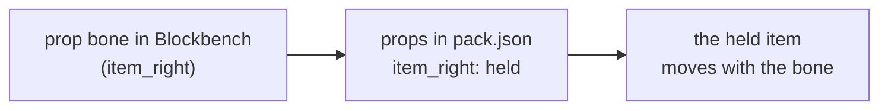
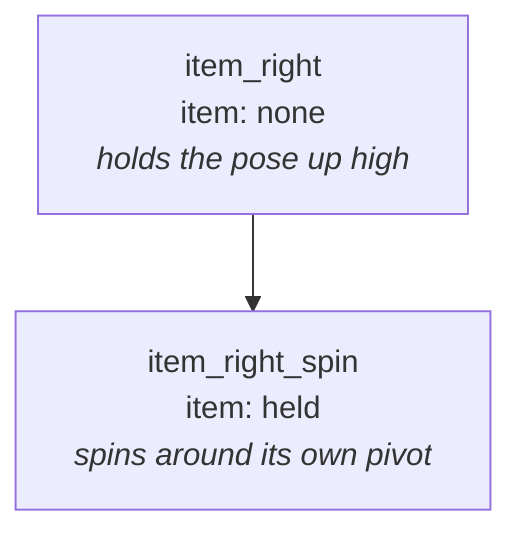

Emotes can move items and blocks around: spin the sword you're holding, throw something in the air, put a block next
to you. The Zelda emote does it with whatever you hold.

## How it works

Any bone that isn't part of the player is a **prop bone**. You animate it like any other bone (rotation, position,
scale), and `props` in `pack.json` says which item it shows.



The [Template](Template) already has a bone for each spot, with a placeholder cube so you see it move:

| Bone | Hangs on | Where it rests |
|------|----------|----------------|
| `item_right` | right hand | in the fist, exactly where held items are |
| `item_left` | left hand | in the fist |
| `prop_body` | torso | centered in the torso |
| `prop_head` | head | centered in the head |
| `prop` | the ground | half a block above the feet, so a block stands on the ground |

## The pack.json part

```json
"juggle": {
  "props": {
    "item_right": "held",
    "sword": { "item": "held_right", "attach": "root", "display": "hand" },
    "prop": "minecraft:oak_stairs"
  }
}
```

Writing just a value (`"item_right": "held"`) is the same as `{ "item": "held" }`.

| Field | Default | What it is |
|-------|---------|------------|
| `item` | `held` | what it shows, see below |
| `attach` | from the bone name | what the bone hangs on: `right_hand`, `left_hand`, `body`, `head` or `root` |
| `display` | `hand` on hands, `none` elsewhere | how the item is drawn |
| `parent`, `pivot` | | for nested props, see below |

**item:**

    minecraft:cake - spawns that item
    held - the item in the hand the prop hangs on, else the main hand
    held_right, held_left - the item in that hand
    held_mainhand, held_offhand - the item in that hand
    none - shows nothing, for bones that only carry other props

**attach** comes from the bone's name if you leave it out: `right` or `left` in it means that hand, `head` the head,
`body` or `torso` the torso, anything else `root`. `root` is the ground under the player, it turns with the player
but ignores the `body` bone.

**display:**

    hand - like a held item
    none - the plain model, blocks are a full block big
    fixed - like in an item frame
    ground - like a dropped item
    head - like on a head

## Things to know

- A held item that a prop moves **leaves the hand**, so it doesn't show twice. An empty hand just shows nothing.
- Scale `0` hides a prop. Scale it back up to show it later.
- Hand props blend in and out from the hand like the rest of the emote, the others pop in and out with it.
- **Throwing and catching:** hang the item on `root` and keyframe its path from the hand, through the air and back.
  A prop hangs on one thing for the whole emote, it can't switch from the hand to the ground.
- At most 8 props per emote.
- Props are only drawn, nobody really holds, drops or loses anything.
- **Keep the pivots** of the template's prop bones (or write the new one in `pivot`). A prop rests where its bone's
  pivot is.

## Nested props

_Fully optional, most emotes never need this._

The game doesn't read your Blockbench model, only the animation, so it doesn't know which bone sits in which. If a
prop bone is nested in another prop bone, tell it with `parent`. It's useful for:

    Spinning on top of a pose - a child bone spins freely while the parent holds the pose, no gimbal lock
    Another turning point - e.g. a sword turning around its middle instead of the grip, give the child its own pivot
    Keyframes and Molang apart - the path keyframed on the parent, a Molang loop on the child

The Zelda emote does the first one:

```json
"zelda_item_get": {
  "props": {
    "item_right": "none",
    "item_right_spin": { "parent": "item_right", "pivot": [-6, 12, -6] }
  }
}
```



`item_right` holds the pose and shows nothing, `item_right_spin` shows the held item and spins around a point in front
of the fist.

- `pivot` is copied straight from Blockbench. Without it, it's the parent's pivot.
- A nested prop only turns around its pivot, the item stays where the top prop rests, like in Blockbench.
- Parents can be nested again, as long as no prop ends up being its own parent.
- `query.life_time` keeps counting while the emote holds its last frame, so a Molang spin on the child keeps going.
