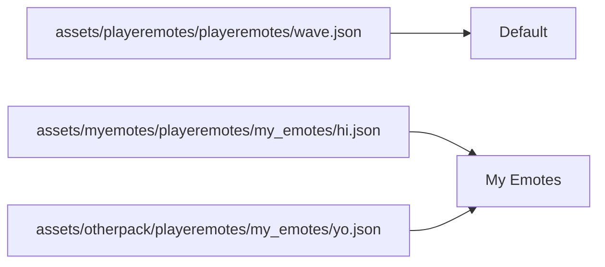

How emote files are organized, and how they end up as sections in *All Emotes*.

## Where emotes go

```
assets/<namespace>/playeremotes/
  pack.json            optional, info and options of the Default pack
  wave.json            files right in here join the "Default" pack
  dances/              every sub-folder is its own pack
    pack.json          optional
    robot_dance.json
    more/              can be nested further, still the "dances" pack
      floss.json
```

- **Resource pack:** `assets/<namespace>/playeremotes/`
- **Data pack** (sent to players by a server): `data/<namespace>/playeremotes/`, see
  [Server Setup](Server-Setup#server-emote-packs)
- **Mod:** same as a resource pack, inside the jar

`<namespace>` is your own name for your stuff, lowercase, like `myemotes`. Emote ids are `<namespace>:<animation
name>`.

## Packs in game

Each folder is one section in *All Emotes*, sorted A-Z. Hovering the header shows the pack's info, and players can
hide whole packs with *Packs...*.

**Same folder name = same pack**, even from different namespaces. Two resource packs that both have a `dances`
folder end up in one *Dances* section. That's also why you should put your emotes in a folder of their own, files
right in `playeremotes/` join my *Default* pack.



## The pack.json

Every pack folder can have a `pack.json`. Everything in it is optional.

```json
{
  "name": "My Emotes",
  "description": "Emotes I made",
  "author": "You",
  "version": "1.0.0",
  "emotes": {
    "my_wave": {
      "look": false,
      "sound": "minecraft:entity.villager.celebrate"
    }
  }
}
```

| Field | What it is |
|-------|------------|
| `name` | the section name (default: the folder name) |
| `description` | shown when hovering the header |
| `author` | your name, `authors` with a list works too |
| `version` | shown when hovering the header |
| `emotes` | options for each emote, everything about these is on [pack.json](Pack-Json) |

## Names and translations

Names come from the lang files, `pack.json` is the fallback.

`assets/<namespace>/lang/en_us.json`:

```json
{
  "emote.myemotes.my_wave": "Friendly Wave",
  "emote.myemotes.my_wave.description": "A big wave",
  "emote_pack.my_emotes": "My Emotes",
  "emote_pack.my_emotes.description": "Emotes I made"
}
```

| Key | For |
|-----|-----|
| `emote.<namespace>.<emote>` | emote name |
| `emote.<namespace>.<emote>.description` | emote description |
| `emote_pack.<folder>` | pack name |
| `emote_pack.<folder>.description` | pack description |

Without any of these, `my_wave` shows as "My Wave".

Data packs have no lang files, so for server packs put the names in `pack.json`:

```json
"emotes": {
  "my_wave": { "name": "Friendly Wave", "description": "A big wave" }
}
```

## Reloading

    Reload Emote Files key - re-reads the emote files, fast, use this while animating
    F3+T - reloads all resources, works too, just slower
    /reload - for data packs on a server

## Sharing your pack

Zip the resource pack folder (the one with `pack.mcmeta` in it) and that's it. Put it on CurseForge, Modrinth or
wherever you like. No need to ask me, go ahead :) I'd love to see what you made, show it on the
[Discord](https://discord.gg/94Qk4MswX5).
