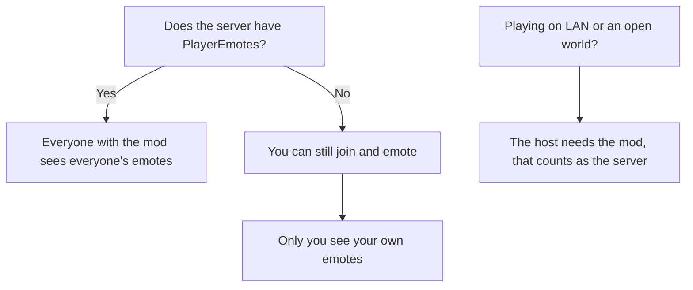

## Players

1. Pick the file for your Minecraft version and loader (the file name says both).
2. Drop it in your `mods` folder.
3. **Fabric only:** you also need [Fabric API](https://modrinth.com/mod/fabric-api).
4. Start the game and **press B**.

That's it.

| Minecraft | Fabric | NeoForge | Forge |
|-----------|:------:|:--------:|:-----:|
| 1.20.1    | ✓      | x        | ✓     |
| 1.21.1    | ✓      | ✓        | ✓     |
| 1.21.4    | ✓      | ✓        | ✓     |
| 1.21.11   | ✓      | ✓        | ✓     |
| 26.1.2    | ✓      | ✓        | x     |
| 26.3      | ✓      | ✓        | x     |

## Keybinds

Most keybinds are edited assigned in-game.

There are a couple of unassigned keybinds by default so keep if those interest you. One of them is to reload emotes. (in-case you are adding things in or swapping anything. Mostly in development enviroments only)

## Multiplayer

Who needs the mod depends on what you want:

- **Server has it:** players with the mod see each other's emotes, partner emotes and `/emotesync` work, and the
  server can send its own emote packs.
- **Server doesn't have it:** you can still join any server with the mod installed. Your emotes only show on your
  screen
- **Players without the mod** can join a server that has it, they just don't see any emotes.

For the server side of things (config, permissions, emote packs from the server), go to [Server Setup](Server-Setup).

## Modpacks

You can put the mod in any modpack, no need to ask me first :)

It's client and server. In a pack that's played on a server, put it on both.

## Optional mods that work with it

    Controlify - play with a controller, the wheel works with it (Fabric/NeoForge)
    Replay Mod / Flashback - emotes show up in your recordings
    LuckPerms - or any permission mod, for server permissions

More on that in [Compatibility](Compatibility).
