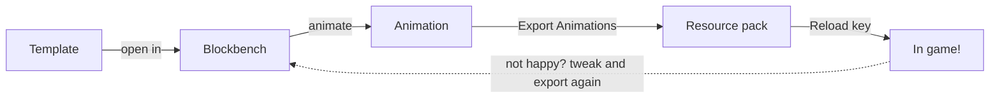

Every emote is just a resource, so you can make your own with a resource pack. No coding, only
[Blockbench](https://www.blockbench.net/) (it's free).

This page gets you from nothing to your first emote in game. The pages after it go deeper into each part.



## What you need

    Blockbench - to animate
    The Template - the player model with the right bones, from the Template page
    A resource pack - where your emotes live, the Template comes with an empty one

## 1. Get the template

Download it from the [Template](Template) page and unzip it. Put the `My Emote Pack` folder in your
`.minecraft/resourcepacks` folder and turn it on in game.

## 2. Open it in Blockbench

*File > Open Model* and pick `player_emote_template.geo.json`. It opens as a Bedrock entity.

If you want to see your skin on it, drag your skin file (64x64) onto the model.

## 3. Animate

Go to the *Animate* tab (top right) and add a new animation with the **+**.

**The animation's name is your emote's id.** Call it `my_wave` and the emote is `my_wave`. A `animation.model.`
in front gets dropped, so `animation.model.my_wave` works the same.

Then rotate and move the bones. The ones you'll use most:

```
body            the whole player
└─ torso        bends at the waist
   ├─ head
   ├─ right_arm
   └─ left_arm
right_leg
left_leg
```

The full list is on the [Template](Template) page.

Set the loop mode in the animation's properties (right click it):

    Play Once - plays and the emote ends
    Loop - keeps going until the player stops it
    Hold On Last Frame - plays, then stays in the last pose. Good for sitting, laying and poses

## 4. Export

*Animation > Export Animations*, tick the ones you want, and save the file into:

```
My Emote Pack/assets/myemotes/playeremotes/my_emotes/
```

Any file name works, one file can have as many animations as you like. The `my_emotes` folder becomes its own
section in *All Emotes*, rename it to whatever your pack is called.

## 5. See it in game

Press the **Reload Emote Files** key. It's **unassigned by default**, set it in *Options > Controls > Key Binds >
PlayerEmotes*. It's much faster than `F3+T`.

Open the wheel, *All Emotes*, and your emote is there :D

Keep Blockbench open while you work: tweak, export over the same file, press the key, look again.

## Giving it a name

Without anything else, `my_wave` shows up as "My Wave". To give it a real name, add a lang file:

`My Emote Pack/assets/myemotes/lang/en_us.json`

```json
{
  "emote.myemotes.my_wave": "Friendly Wave",
  "emote.myemotes.my_wave.description": "A big wave with both arms",
  "emote_pack.my_emotes": "My Emotes"
}
```

## Where to go next

- [Emote Packs](Emote-Packs) - folders, sections in the list, sharing your pack
- [pack.json](Pack-Json) - sounds, held items, random variants and every other option
- [Animation Features](Animation-Features) - what from Blockbench works (easing, Molang, scale...)
- [Sounds and Particles](Sounds-and-Particles) - keyframe sounds and particles in the animation
- [Animated Props](Animated-Props) - move items and blocks around
- [Elbows and Knees](Elbows-and-Knees) - bending limbs
- [Making Partner Emotes](Making-Partner-Emotes) - emotes for two players
- [Tips](Tips) - how to make them look good
