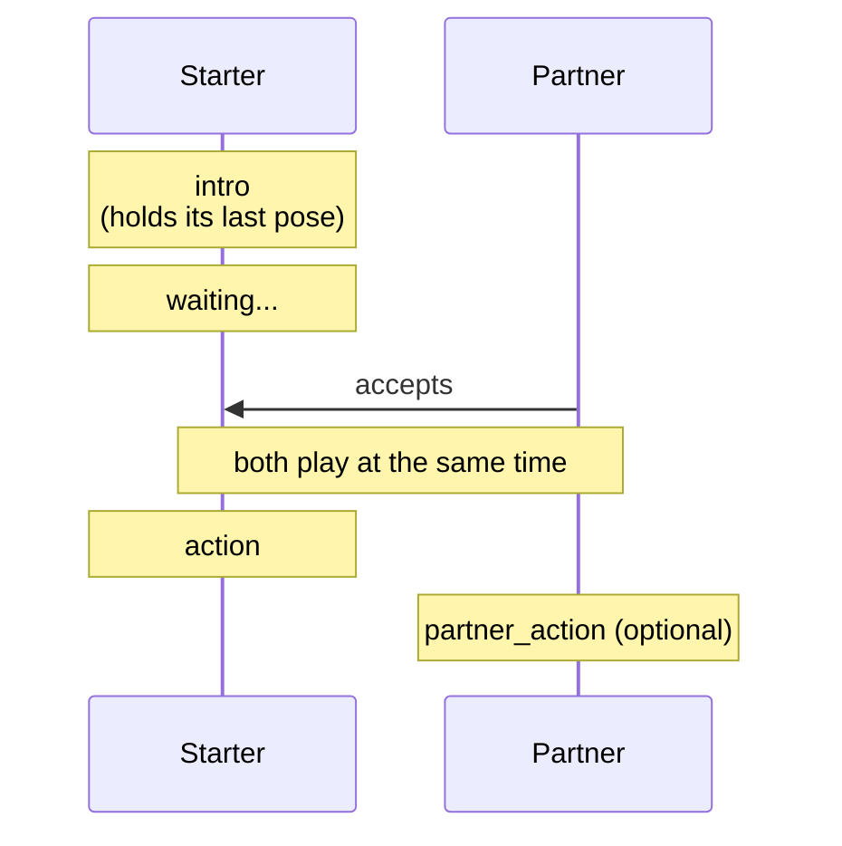

Emotes for two players, like the hug or the high five. How players use them is on
[Partner Emotes](Partner-Emotes), this page is about making them.

## The three parts

A partner emote is three animations:



    intro - the starter plays this while waiting, like holding a hand up for a high five
    action - the starter plays this once someone joined
    partner_action - what the partner plays, the same as action if you leave it out (optional)**

in the pack.json
```json
"high_five": {
  "look": false,
  "partner": {
    "intro": "high_five_intro",
    "action": "high_five",
    "partner_action": "high_five",
    "distance": 0.9
  }
}
```

| Field | Default | What it is |
|-------|---------|------------|
| `intro` | | played while waiting |
| `action` | the emote's animation | the starter's part |
| `partner_action` | same as `action` | the partner's part |
| `distance` | `1` | blocks between the two players during the action |

The intro and action animations don't show up as emotes of their own.

## The intro

Give it `"loop": "hold_on_last_frame"`, so the starter keeps holding the pose while they wait.

## Lining them up

This is the important part. **Animate both actions as if the partner stands `distance` blocks in front of the
starter, facing back.**

```
        starter              partner
          -->      0.9 blocks   <--
           O  _________________  O
```

In game nobody gets moved. Each player's game draws both of them exactly where the animations expect them, so if
your animation is made for 0.9 blocks, `distance` must say 0.9.

The easiest way to get it right in Blockbench: put two templates in one project, the second one turned around 180
degrees and moved `distance * 16` pixels forward. Animate both, then export each one's animation on its own.

## Same or different parts?

- **Same part** (high five): both do the same thing mirrored to each other, leave out `partner_action`.
- **Different parts** (fusion dance): the partner does the mirror image of the starter, so it needs its own
  animation. Give it in `partner_action`.

## Sounds

Sound and particle keyframes play for each player's own animation. If both play the same action (like the high
five), both make the sound, which is what you want for a clap. For a sound only one of them should make, put it in
only one of the two actions. See [Sounds and Particles](Sounds-and-Particles).
