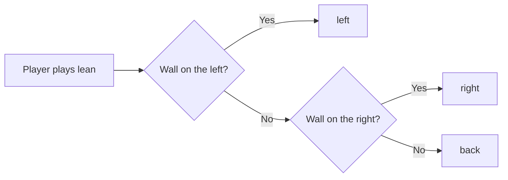

Every option an emote can have. They all go in the `emotes` part of a [pack.json](Emote-Packs#the-packjson), under
the emote's id, and they're all optional.

```json
{
  "emotes": {
    "my_wave": {
      "look": false,
      "sound": "minecraft:entity.villager.celebrate"
    }
  }
}
```

An emote you don't write in here still works, with every option on its default. You only need an entry to change
something.

## All options

| Option | Default | What it does |
|--------|---------|--------------|
| [`animation`](#animations-and-pick) | the emote's id | the animation it plays |
| [`animations`](#animations-and-pick) | | several animations, one is picked each time |
| [`pick`](#animations-and-pick) | `cycle` | `cycle` (in order) or `random` |
| [`look`](#look) | `true` | the head follows the camera |
| [`sound`](#sound) | | a sound when the emote starts |
| [`item`](#item) | | an item held while emoting |
| [`props`](#props) | | items moved by their own bones |
| [`partner`](#partner) | | makes it a two-player emote |
| [`selector`, `variants`](#selector-and-variants) | | picks an animation from the world around the player |
| [`blend_in`, `blend_out`](#blend_in-and-blend_out) | `0.15`, `0.2` | seconds to blend from and back to the normal pose |
| [`bend_style`](#bend_style) | `smooth` | how bent elbows and knees look |
| [`preview`](#preview) | the middle | which moment the menus show |
| `name`, `description` | | fallback name and description, for packs without lang files |
| `author` | | shown in the emote list |
| `order` | `0` | sort order in its section, lower first, then by name |

## animations and pick

By default an emote plays the animation with its own name. Point it to another one, or give it a few to choose from:

```json
"dance": {
  "animations": ["dance", "dance2", "dance3"],
  "pick": "random"
}
```

`cycle` plays them in order, one each time, `random` picks one.

Animations that an emote uses (like `dance2` and `dance3` above) **don't become emotes of their own**, so they don't
fill up the list.

Animations from other namespaces work too: `"mymod:dance"`.

## look

```json
"bow": { "look": false }
```

With `true`, the head keeps following where the player looks, on top of the animation. Good for idle stuff like
sitting. Turn it **off** for anything where the head is part of the animation (bows, facepalms, dances), otherwise
it fights your keyframes.

## sound

Plays when the emote starts, follows the player and stops with the emote.

```json
"cheer": { "sound": "minecraft:entity.villager.celebrate" }
```

```json
"laugh": {
  "sound": { "id": "minecraft:entity.witch.celebrate", "volume": 0.8, "pitch": 1.0, "range": 8 }
}
```

`range` is how far it's heard in blocks (default 8, max 16). For sounds at exact moments of the animation and your
own sound files, see [Sounds and Particles](Sounds-and-Particles).

## item

An item in the player's hand while the emote plays, in place of what they hold.

```json
"eat_cake": { "item": "minecraft:cake" }
```

```json
"drums": { "item": { "id": "minecraft:stick", "hand": "both" } }
```

`hand` is `right` (default), `left` or `both`. The item only stays in the hand, to move it around use `props`.

## props

Items and blocks moved by their own bones, everything about it is on [Animated Props](Animated-Props).

```json
"juggle": {
  "props": {
    "item_right": "held",
    "prop": "minecraft:oak_stairs"
  }
}
```

## partner

Makes it a two-player emote, everything about it is on [Making Partner Emotes](Making-Partner-Emotes).

```json
"high_five": {
  "look": false,
  "partner": { "intro": "high_five_intro", "action": "high_five", "distance": 0.9 }
}
```

## selector and variants

Lets the emote pick an animation from the world around the player. The built-in selector is `lean`: it leans on a
wall to the left or right if there is one, else it leans back.

```json
"lean": {
  "selector": "lean",
  "variants": {
    "left": "lean_left",
    "right": "lean_right",
    "back": ["lean_back", "lean_back_2"]
  }
}
```



A variant can be one animation or a list (then `pick` decides). If the selector doesn't exist or picks a group you
didn't write, the emote plays its `animations` instead, so it's a good idea to give it those as a fallback.

**For mod developers:** you can add your own selectors from code, it returns the name of the variant group:

```java
EmoteSelectors.register("weather", minecraft -> minecraft.level != null && minecraft.level.isRaining() ? "rain" : "sun");
```

## blend_in and blend_out

```json
"sit_rest": { "blend_in": 0.3, "blend_out": 0.4 }
```

Seconds the player takes to blend from their normal pose into the emote, and back out at the end. Longer feels
softer, shorter feels snappier. Set `0` if the animation already starts from the standing pose itself.

## bend_style

Only matters if the emote bends elbows or knees, see [Elbows and Knees](Elbows-and-Knees).

```json
"stretch": { "bend_style": "split" }
```

`smooth` (default) bends one limb, `split` turns two halves into each other like the Blockbench preview. Players can
still override it in their settings.

## preview

```json
"kamehameha": { "preview": 2.5 }
```

The wheel shows each emote as a still pose until you hover it. This is the second of the animation it shows. By
default it's the middle, which is usually fine, but for an emote whose best moment is later (or earlier), set it.

## A full example

```json
{
  "name": "Party",
  "description": "Party emotes",
  "author": "You",
  "version": "1.0.0",
  "emotes": {
    "party_dance": {
      "animations": ["party_dance", "party_dance_2"],
      "pick": "random",
      "look": false,
      "sound": { "id": "minecraft:entity.villager.celebrate", "volume": 0.7 },
      "blend_in": 0.25,
      "order": 1
    },
    "toast": {
      "look": false,
      "item": "minecraft:honey_bottle",
      "preview": 1.2,
      "order": 2
    }
  }
}
```
