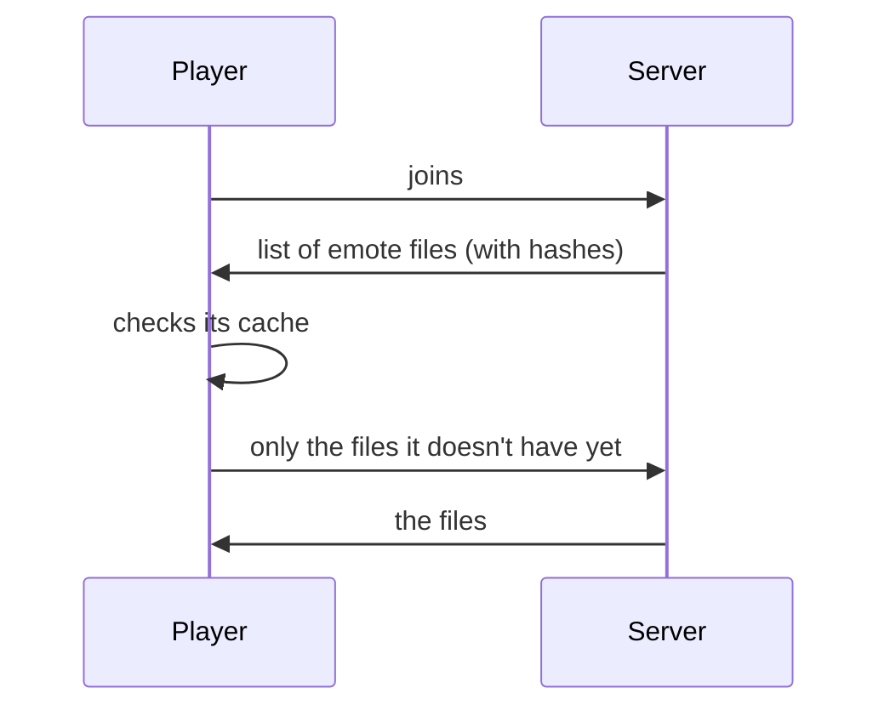

One stop for everything server side. If you only play singleplayer, you don't need any of this.

**Only in the case of multiplayer**, the mod needs to be on the server (or the person hosting) so players see each
other's emotes. Players without the mod can still join, they just don't see emotes.

## The config

`config/playeremotes-server.json` is written the first time the server starts. Change it and run
`/playeremotes reload`, no restart needed.

```json
{
  "enabled": true,
  "cooldownTicks": 4,
  "disabledEmotes": [],
  "restrictedEmotes": [],
  "syncEmotes": true,
  "partnerEmotes": true,
  "partnerRequestSeconds": 60,
  "sendServerPacks": true
}
```

| Field | Default | What it does |
|-------|---------|--------------|
| `enabled` | `true` | emotes at all |
| `cooldownTicks` | `4` | fewest ticks between two emotes of one player (20 ticks = 1 second, max 1200) |
| `disabledEmotes` | `[]` | emotes nobody can play |
| `restrictedEmotes` | `[]` | emotes only players with `playeremotes.restricted` can play |
| `syncEmotes` | `true` | whether `/emotesync` works |
| `partnerEmotes` | `true` | two-player emotes |
| `partnerRequestSeconds` | `60` | how long a partner request waits for an answer (5 to 600) |
| `sendServerPacks` | `true` | send emote packs from data packs to players |

If the file is broken (a typo, a missing comma), the server tells you in the log and uses the defaults until it's
fixed.

### Disabling and restricting emotes

Three ways to write an emote in `disabledEmotes` and `restrictedEmotes`:

```json
"disabledEmotes": [
  "playeremotes:t_pose",     // this exact emote
  "floss",                   // floss from any pack
  "somepack:*"               // every emote of a namespace
]
```

_(JSON doesn't allow comments, they're only here to explain, please leave them out in the real file. Don't copy-paste that for whatever reason.)_

The **default** ids are in the [Emote List](Emote-List). A disabled emote's animations are blocked too, so another emote can't
sneak them in.

## Permissions

Without a permission mod, the operator level decides.

| Permission | What for | Op level without a permission mod |
|------------|----------|:---------------------------------:|
| `playeremotes.use` | playing emotes | 0 (everyone) |
| `playeremotes.sync` | `/emotesync` | 0 (everyone) |
| `playeremotes.partner` | partner emotes | 0 (everyone) |
| `playeremotes.restricted` | the emotes in `restrictedEmotes` | 2 |
| `playeremotes.command.reload` | `/playeremotes reload` | 3 |

Example with LuckPerms, a VIP-only emote:

```
/lp group default permission set playeremotes.restricted false
/lp group vip permission set playeremotes.restricted true
```

```json
"restrictedEmotes": ["playeremotes:kamehameha"]
```

## Commands

```
/playeremotes reload         re-reads the config
/emote <emote>               play an emote
/emotesync <player>          join a player's emote
/emoteaccept                 accept a partner emote request
```

## Server Emote Packs

You can give every player your own emotes, they don't need to install anything. Put emote packs in a **data pack**,
players download them when joining.

```
world/datapacks/my_server_emotes/
  pack.mcmeta
  data/
    myserver/
      playeremotes/
        pack.json
        my_emote.json
```

Same layout as in a resource pack, only `data/` instead of `assets/`. How to make the emotes themselves is on
[Making Emotes](Making-Emotes), and the folder layout on [Emote Packs](Emote-Packs).



- Players only download each file once, it's cached in `.minecraft/playeremotes/server-packs/`
- After `/reload` on the server, players get the changed files.
- Limits: 2 MB per file, 16 MB in total.
- Data packs have no translations, so names come from `pack.json` (`name`, `description`).
- Sounds can't be sent this way, a server pack can only use sounds the players already have (vanilla ones work).

Turn it off with `"sendServerPacks": false`.
