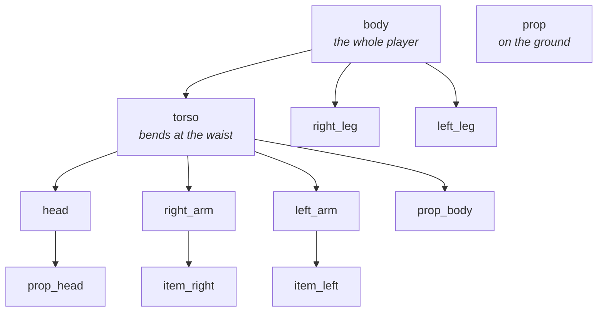

Everything you need to start making emotes, in one zip.

<p align="center">
  <a href="https://raw.githubusercontent.com/wiki/YamiKhal/PlayerEmotes/files/PlayerEmotes-Template.zip"><b>Download the Template</b></a>
</p>

## What's inside

```
PlayerEmotes Template/
  player_emote_template.geo.json             the player, straight arms and legs
  player_emote_template_bendable.geo.json    the player, elbows and knees you can bend
  My Emote Pack/                             resource pack, ready to drop in resourcepacks
    pack.mcmeta
    assets/myemotes/
      lang/en_us.json                        names and descriptions
      playeremotes/my_emotes/
        pack.json                            pack info and emote options
        example_wave.json                    an example, replace it with yours
  My Server Emotes/                          the same as a data pack, for servers
  README.txt
```

    player_emote_template - use this one for most emotes
    player_emote_template_bendable - only if you want bent elbows and knees, see Elbows and Knees
    My Emote Pack - goes in .minecraft/resourcepacks
    My Server Emotes - goes in <world>/datapacks, only if you run a server and want players to get your emotes

Rename `myemotes` (the namespace) and `my_emotes` (the pack) to something of your own, lowercase, no spaces. Don't
forget to change the lang file to match.

If Minecraft says the pack is made for another version, turn it on anyway, it works.

## The bones

The hierarchy is the same as in the game, a bone moves everything nested in it.



| Bone | What it is | Pivot (Blockbench) |
|------|------------|--------------------|
| `body` | the whole player, move this to lift, lower or turn everything | `0, 12, 0` |
| `torso` | bends at the waist, carries the head and arms | `0, 12, 0` |
| `head` | | `0, 24, 0` |
| `right_arm`, `left_arm` | | `-5, 22, 0` / `5, 22, 0` |
| `right_leg`, `left_leg` | | `-1.9, 12, 0` / `1.9, 12, 0` |
| `item_right`, `item_left` | a prop in the hand, see [Animated Props](Animated-Props) | `-6, 12, -2` / `6, 12, -2` |
| `prop_body`, `prop_head` | a prop in the torso / head | `0, 18, 0` / `0, 28, 0` |
| `prop` | a prop on the ground | `0, 8, 0` |

The bendable template also has these, see [Elbows and Knees](Elbows-and-Knees):

| Bone | Pivot (Blockbench) |
|------|--------------------|
| `right_lower_arm`, `left_lower_arm` | `-6, 18, 0` / `6, 18, 0` |
| `right_lower_leg`, `left_lower_leg` | `-1.9, 6, 0` / `1.9, 6, 0` |

**Don't move the pivots.** The game uses its own player model, it only reads your animation. If you move a pivot in
Blockbench, it looks right there and wrong in game.

You can add more bones though, any bone that isn't one of these becomes a prop bone, see
[Animated Props](Animated-Props).

## Tips for the template

- Drag your own skin (64x64) onto the model to see what it'll look like.
- The prop bones have a placeholder cube so you see them move. Put any model in there for the preview, the game
  only uses the animation.
- Your `.bbmodel` (*File > Save Project*) is only for you, the game never needs it. Keep it next to the pack so you
  can come back to your animations later.

Next: [Making Emotes](Making-Emotes)
