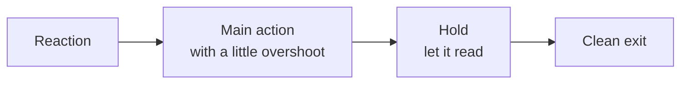

Things I learned making the emotes for this mod. Most of them the hard way :)

_The first part is for players, the rest is for making emotes._

## Playing

    Favorites first - put the ones you use most on page 1, slots 1-4 have their own hotkeys
    Hotkeys - bind Play Wheel Slot 1-4 for your top 4, no wheel needed
    Recently Used - the folded section at the top of All Emotes, faster than searching
    Hold to Open Wheel - if you play a lot of emotes quick, hold B, let go over one, done
    Join the dance - /emotesync <name> and you're in step with them, works great for group photos
    Waiting for a partner - you don't need to find someone first, start it and whoever walks up can join

## Making emotes look good

The bellow is aimed at newcomers who haven't animated before. Just little things I wrote for myself as I was making the animations.

### Tell a small story

The ones that feel best have clear beats, not just motion:

The facepalm is a good example: a small "ugh" reaction, the hand goes to the face and bumps a bit on impact, a
long hold where the head shakes slowly, then back to standing. About 3-4 seconds for a one-shot emote.

### Keep the torso small

This one surprised me. Big torso moves read as bowing or begging, not as emotion. The **head and hands carry the
feeling**, the torso only does a few degrees (a sigh, a small recoil).

Same for the free arm: let it hang and sway a little instead of doing nothing, or doing too much.

### Don't overdo it, don't underdo it

    Too much - doubled over, stomping, waving, everything moving at once. Reads as robotic
    Too little - a still pose with tiny fast pulses. Reads as jittering
    Just right - one or two big slow moves that carry it, slow rhythm on top (about 0.25 s apart), at most one gesture

Keep it minecrafty. Even "dying of laughter" looks better as leaning back and shaking than rolling on the floor.

### Where to look

A head turning left and right looks like someone searching for help. For happy or energetic emotes, keep the eyes
forward or up.

### Dances

    Start at the hips - the movement comes from the hips, the feet stay planted
    Lag behind - torso, then head, then arms follow a little later, not all at once
    One move per beat - not more, and give the eyes time to read it
    Eased moves - 0.2 to 0.3 s per move, not instant snaps
    Phrases - about 8 seconds: a move, repeat it, a variation, a hit, recover

If the feet slide around while the body moves, the dance looks like it's pulled by a string. Rotate the legs to keep
the feet on the ground.

### Poses and idles

For sitting, laying and other held poses, use *Hold On Last Frame*, and add a bit of breathing with Molang (see
[Animation Features](Animation-Features#molang)). Calm is good here.

### Hands touching things

If a hand touches the face or the body, check it from a few angles in Blockbench. When the head moves, move the arm
with it so the hand stays on the face instead of floating off.

### Odd placements are fine

Minecraft's player is made of boxes. Sometimes an arm has to be a bit detached, or overlap a little, or be moved
somewhere odd for the whole thing to look right from the outside. Within reason, that's fine. Judge it in game, from
the third person camera, not from inside the model.

## Workflow

- Keep Blockbench open next to the game, export, press the *Reload Emote Files* key, look, repeat.
- Look at it in third person from the front **and** from the side.
- Look at it with armor on, and with something in your hand.
- Set `look` to `false` unless the head should follow the camera, otherwise your head keyframes fight the player's
  mouse.
- Set `preview` in pack.json to the best moment, that's what people see in the wheel.
- Save the `.bbmodel` project, the game doesn't need it but you will.
- Straight limbs look the most like Minecraft. Bending is there if you want it, but you don't need it.

## Ideas to steal

    Use held items - "held" props make the emote use what the player holds, the Zelda one does this
    Sounds at the right moment - a crit sound on a high five clap goes a long way
    Random variants - 2-3 versions of the same emote with "pick": "random" so it doesn't feel repetitive
    The lean selector - one emote that leans on walls by itself
